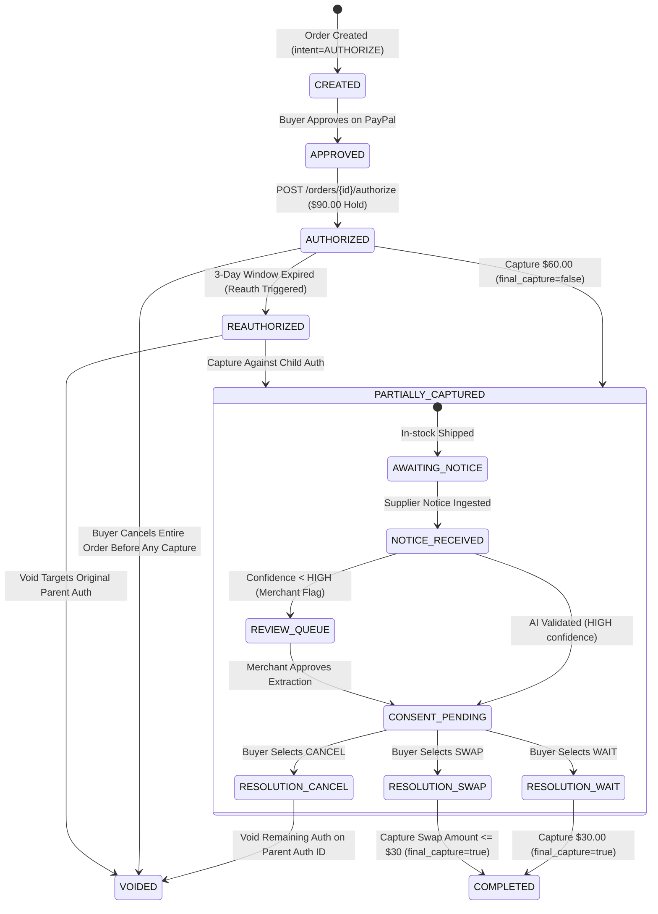

# 01-CONTRACTS.MD — STATE MACHINES, DATA MODELS, API CONTRACTS & GATEWAY SPECS
## AuthHorizon — PayPal AI Hackathon 2026
**Frozen on:** 2026-11-09 @ 18:55 IST  
**Status:** FROZEN CONTRACTS.

---

## 1. Unified State Machine & Transition Matrix



### Transition Table

| Current State | Trigger Event | Target State | Permitted Actor | Side Effects & Invariants |
|---|---|---|---|---|
| `CREATED` | Buyer approves checkout on PayPal sandbox | `APPROVED` | Buyer | Stores PayPal Order ID; zero funds captured. |
| `APPROVED` | Merchant calls `POST /api/orders/{id}/authorize` | `AUTHORIZED` | Merchant Backend | Calls PayPal Authorize endpoint. Creates parent `auth_id`. Hold Bar displays solid $90.00. |
| `AUTHORIZED` | In-stock shipment ready (`POST /api/orders/{id}/ship-partial`) | `PARTIALLY_CAPTURED` | Merchant Backend | Calls PayPal Capture with `$60.00`, `final_capture: false`. Reconciler verifies PayPal status is `PARTIALLY_CAPTURED`. Hold Bar splits into $60 Green / $30 Amber. |
| `PARTIALLY_CAPTURED` | Supplier notice arrives (`POST /api/supplier/parse-notice`) | `NOTICE_INGESTED` | System / Merchant | AI extracts SKU and ship date. If any confidence < HIGH, flags for merchant review. |
| `PARTIALLY_CAPTURED` | Buyer selects WAIT on Consent Portal | `RESOLVING_WAIT` | Buyer | Extends hold expectation. No money movement until fulfillment. Generates tamper-evident hash. |
| `PARTIALLY_CAPTURED` | Buyer selects SWAP on Consent Portal | `RESOLVING_SWAP` | Buyer | Verifies replacement price <= $30.00. Captures swap amount with `final_capture: true`. |
| `PARTIALLY_CAPTURED` | Buyer selects CANCEL on Consent Portal | `VOIDED` | Buyer | Calls `POST /v2/payments/authorizations/{parent_auth_id}/void`. Releases $30.00 hold. Hold Bar animates amber segment to $0. |
| `RESOLVING_WAIT` | Delayed item ships (`POST /api/orders/{id}/fulfill-delayed`) | `COMPLETED` | Merchant Backend | Captures `$30.00` with `final_capture: true`. Hold Bar becomes 100% green. |
| `RESOLVING_SWAP` | Swap item captured | `COMPLETED` | System | Reconciler checks captured amount matches replacement price. |
| `AUTHORIZED` | 29-day / 3-day hold refresh triggered | `REAUTHORIZED` | System | Calls PayPal Reauthorize. New child auth generated; parent auth tracked in DB for void routing. |

---

## 2. Database Schema (SQLite 3 + SQLAlchemy 2.0)

```
┌─────────────────────────────────┐       ┌─────────────────────────────────┐
│             orders              │       │           line_items            │
├─────────────────────────────────┤       ├─────────────────────────────────┤
│ id (PK, Integer)                │◄──────│ id (PK, Integer)                │
│ paypal_order_id (String, Unique)│   1:N │ order_id (FK -> orders.id)      │
│ parent_auth_id (String, Indexed)│       │ sku (String)                    │
│ child_auth_id (String, Nullable)│       │ name (String)                   │
│ total_amount (Float)            │       │ unit_amount (Float)             │
│ captured_amount (Float, Def: 0) │       │ status (IN_STOCK/DELAYED/...)   │
│ held_amount (Float)             │       │ is_delayed (Boolean)            │
│ currency (String, Def: 'USD')   │       └─────────────────────────────────┘
│ status (Enum)                   │
│ created_at (DateTime)           │       ┌─────────────────────────────────┐
│ updated_at (DateTime)           │       │          delay_notices          │
└────────────────┬────────────────┘       ├─────────────────────────────────┤
                 │                   1:N  │ id (PK, Integer)                │
                 ├───────────────────────►│ order_id (FK -> orders.id)      │
                 │                        │ raw_text (Text)                 │
                 │                        │ language (String)               │
                 │                        │ extracted_sku (String)          │
                 │                        │ new_ship_date (String)          │
                 │                        │ reason (Text)                   │
                 │                        │ confidence_sku (String)         │
                 │                        │ confidence_date (String)        │
                 │                        │ confidence_reason (String)      │
                 │                        │ status (PENDING/APPROVED)       │
                 │                        └─────────────────────────────────┘
                 │
                 │ 1:N                    ┌─────────────────────────────────┐
                 ├───────────────────────►│         buyer_consents          │
                 │                        ├─────────────────────────────────┤
                 │                        │ id (PK, Integer)                │
                 │                        │ order_id (FK -> orders.id)      │
                 │                        │ choice (WAIT/SWAP/CANCEL)       │
                 │                        │ swap_sku (String, Nullable)     │
                 │                        │ displayed_text (Text)           │
                 │                        │ timestamp (DateTime)            │
                 │                        │ prev_hash (String)              │
                 │                        │ consent_hash (String, SHA-256)  │
                 │                        └─────────────────────────────────┘
                 │
                 │ 1:N                    ┌─────────────────────────────────┐
                 └───────────────────────►│         capture_audits          │
                                          ├─────────────────────────────────┤
                                          │ id (PK, Integer)                │
                                          │ order_id (FK -> orders.id)      │
                                          │ paypal_capture_id (String)      │
                                          │ idempotency_key (UUID)          │
                                          │ amount (Float)                  │
                                          │ final_capture (Boolean)         │
                                          │ verified_via_reconciler (Bool)  │
                                          │ webhook_received (Boolean)      │
                                          │ created_at (DateTime)           │
                                          └─────────────────────────────────┘
```

### Table Definitions & Column Constraints

#### 1. Table `orders`
- `id`: INTEGER PRIMARY KEY AUTOINCREMENT
- `paypal_order_id`: VARCHAR(64) UNIQUE NOT NULL (Indexed)
- `parent_auth_id`: VARCHAR(64) UNIQUE NULL (Indexed)
- `child_auth_id`: VARCHAR(64) NULL (Set only if reauthorization occurs)
- `total_amount`: NUMERIC(10, 2) NOT NULL
- `captured_amount`: NUMERIC(10, 2) NOT NULL DEFAULT 0.00
- `held_amount`: NUMERIC(10, 2) NOT NULL DEFAULT 0.00
- `currency`: VARCHAR(3) NOT NULL DEFAULT 'USD'
- `status`: VARCHAR(32) NOT NULL DEFAULT 'CREATED' (`CREATED`, `APPROVED`, `AUTHORIZED`, `PARTIALLY_CAPTURED`, `COMPLETED`, `VOIDED`, `REAUTHORIZED`)
- `created_at`: TIMESTAMP NOT NULL DEFAULT CURRENT_TIMESTAMP
- `updated_at`: TIMESTAMP NOT NULL DEFAULT CURRENT_TIMESTAMP

#### 2. Table `line_items`
- `id`: INTEGER PRIMARY KEY AUTOINCREMENT
- `order_id`: INTEGER NOT NULL REFERENCES `orders(id)` ON DELETE CASCADE
- `sku`: VARCHAR(64) NOT NULL
- `name`: VARCHAR(255) NOT NULL
- `unit_amount`: NUMERIC(10, 2) NOT NULL
- `quantity`: INTEGER NOT NULL DEFAULT 1
- `status`: VARCHAR(32) NOT NULL DEFAULT 'IN_STOCK' (`IN_STOCK`, `DELAYED`, `SWAPPED`, `CANCELLED`, `SHIPPED`)
- `is_delayed`: BOOLEAN NOT NULL DEFAULT 0

#### 3. Table `delay_notices`
- `id`: INTEGER PRIMARY KEY AUTOINCREMENT
- `order_id`: INTEGER NOT NULL REFERENCES `orders(id)` ON DELETE CASCADE
- `raw_text`: TEXT NOT NULL
- `language`: VARCHAR(10) NOT NULL
- `extracted_sku`: VARCHAR(64) NULL
- `new_ship_date`: VARCHAR(64) NULL
- `reason`: TEXT NULL
- `confidence_sku`: VARCHAR(10) NOT NULL (`HIGH`, `MED`, `LOW`)
- `confidence_date`: VARCHAR(10) NOT NULL (`HIGH`, `MED`, `LOW`)
- `confidence_reason`: VARCHAR(10) NOT NULL (`HIGH`, `MED`, `LOW`)
- `status`: VARCHAR(32) NOT NULL DEFAULT 'PENDING_REVIEW' (`PENDING_REVIEW`, `APPROVED`, `REJECTED`)
- `created_at`: TIMESTAMP NOT NULL DEFAULT CURRENT_TIMESTAMP

#### 4. Table `buyer_consents` (Tamper-Evident Hash Chain)
- `id`: INTEGER PRIMARY KEY AUTOINCREMENT
- `order_id`: INTEGER NOT NULL REFERENCES `orders(id)` ON DELETE CASCADE
- `choice`: VARCHAR(16) NOT NULL (`WAIT`, `SWAP`, `CANCEL`)
- `swap_sku`: VARCHAR(64) NULL
- `swap_price`: NUMERIC(10, 2) NULL
- `displayed_text`: TEXT NOT NULL (Exact string rendered to buyer)
- `timestamp`: VARCHAR(32) NOT NULL (ISO 8601 UTC)
- `prev_hash`: VARCHAR(64) NOT NULL (SHA-256 of the prior consent record or Genesis Hash)
- `consent_hash`: VARCHAR(64) NOT NULL (SHA-256 of canonical JSON)

#### 5. Table `capture_audits`
- `id`: INTEGER PRIMARY KEY AUTOINCREMENT
- `order_id`: INTEGER NOT NULL REFERENCES `orders(id)` ON DELETE CASCADE
- `paypal_capture_id`: VARCHAR(64) NOT NULL (Indexed)
- `idempotency_key`: VARCHAR(64) NOT NULL UNIQUE
- `amount`: NUMERIC(10, 2) NOT NULL
- `final_capture`: BOOLEAN NOT NULL
- `verified_via_reconciler`: BOOLEAN NOT NULL DEFAULT 0
- `webhook_received`: BOOLEAN NOT NULL DEFAULT 0
- `created_at`: TIMESTAMP NOT NULL DEFAULT CURRENT_TIMESTAMP

---

## 3. Cryptographic Tamper-Evident Consent Specification

### Canonical Hashing Algorithm
1. The consent entry is serialized as **Canonical JSON** (lexicographically sorted keys, no whitespace, UTF-8):
```json
{
  "choice": "WAIT",
  "displayed_text": "We will hold $30.00 until your Ceramic Coating Kit ships on Nov 18, 2026. You may cancel at any time prior to shipment.",
  "order_id": 1,
  "prev_hash": "e3b0c44298fc1c149afbf4c8996fb92427ae41e4649b934ca495991b7852b855",
  "swap_sku": null,
  "timestamp": "2026-11-09T18:55:00.000000Z"
}
```
2. Compute `consent_hash = SHA256(canonical_json)`.
3. Genesis Hash for the first entry in an order: `SHA256("GENESIS:" + paypal_order_id)`.
4. Verification: Any modification of `displayed_text`, `timestamp`, or `choice` breaks the hash chain.
5. **Positioning Rule:** Termed strictly **"tamper-evident consent log"**, never "legally admissible proof".

---

## 4. Backend REST API Specifications

| Method | Endpoint | Request Body | Response (200/201) | Error Codes |
|---|---|---|---|---|
| `POST` | `/api/orders/create` | `{ "items": [...] }` | `{ "id": 1, "paypal_order_id": "...", "approval_url": "..." }` | 400, 502 |
| `POST` | `/api/orders/{id}/authorize` | `{}` | `{ "auth_id": "...", "status": "AUTHORIZED", "held_amount": 90.00 }` | 404, 409, 502 |
| `POST` | `/api/orders/{id}/ship-partial` | `{ "shipped_skus": ["SKU-001", "SKU-002"] }` | `{ "capture_id": "...", "captured_amount": 60.00, "held_amount": 30.00, "status": "PARTIALLY_CAPTURED" }` | 400, 404, 502 |
| `POST` | `/api/supplier/parse-notice` | `{ "order_id": 1, "raw_text": "..." }` | `{ "extraction": { ... }, "status": "APPROVED" | "PENDING_REVIEW" }` | 422, 500 |
| `POST` | `/api/consent/submit` | `{ "order_id": 1, "choice": "WAIT"|"SWAP"|"CANCEL", "swap_sku": null }` | `{ "choice": "...", "consent_hash": "...", "next_action": "..." }` | 400, 404, 409 |
| `POST` | `/api/orders/{id}/fulfill-delayed`| `{}` | `{ "capture_id": "...", "status": "COMPLETED", "final_capture": true }` | 400, 404, 502 |
| `POST` | `/api/webhooks/paypal` | Raw PayPal Webhook JSON + Headers | `{ "status": "VERIFIED", "event_type": "..." }` | 400, 401 |
| `GET` | `/api/orders/{id}` | None | Complete Order Object with items, audits, notice, and consent chain | 404 |
| `GET` | `/api/orders` | None | Array of all orders (for AG Grid dashboard) | 200 |

---

## 5. PayPal REST API Call Contracts

### 1. Create Order (`POST /v2/checkout/orders`)
- **Headers:** `Authorization: Bearer {token}`, `Content-Type: application/json`, `PayPal-Request-Id: {uuid}`
- **Payload:**
```json
{
  "intent": "AUTHORIZE",
  "purchase_units": [
    {
      "reference_id": "PU-AUTH-001",
      "amount": {
        "currency_code": "USD",
        "value": "90.00",
        "breakdown": {
          "item_total": { "currency_code": "USD", "value": "90.00" }
        }
      },
      "items": [
        { "name": "Precision Bearings", "sku": "SKU-BEAR-01", "unit_amount": { "currency_code": "USD", "value": "30.00" }, "quantity": "1" },
        { "name": "Hydraulic Pump", "sku": "SKU-PUMP-02", "unit_amount": { "currency_code": "USD", "value": "30.00" }, "quantity": "1" },
        { "name": "Ceramic Coating Kit", "sku": "SKU-COAT-03", "unit_amount": { "currency_code": "USD", "value": "30.00" }, "quantity": "1" }
      ]
    }
  ]
}
```

### 2. Authorize Order (`POST /v2/checkout/orders/{id}/authorize`)
- **Headers:** `Authorization: Bearer {token}`, `Content-Type: application/json`, `PayPal-Request-Id: {uuid}`
- **Response Extraction:** Extract `purchase_units[0].payments.authorizations[0].id` -> Store as `parent_auth_id`.

### 3. Partial Capture (`POST /v2/payments/authorizations/{auth_id}/capture`)
- **Headers:** `Authorization: Bearer {token}`, `Content-Type: application/json`, `PayPal-Request-Id: {uuid}`
- **First Capture (In-Stock):**
```json
{
  "amount": { "currency_code": "USD", "value": "60.00" },
  "final_capture": false,
  "invoice_id": "INV-SPLIT-60",
  "note_to_payer": "Fulfillment for in-stock items SKU-BEAR-01 and SKU-PUMP-02"
}
```
- **Final Capture (Wait Resolution):**
```json
{
  "amount": { "currency_code": "USD", "value": "30.00" },
  "final_capture": true,
  "invoice_id": "INV-FINAL-30",
  "note_to_payer": "Fulfillment for delayed item SKU-COAT-03"
}
```

### 4. Void Remaining Authorization (`POST /v2/payments/authorizations/{parent_auth_id}/void`)
- **Target:** Must be called on `parent_auth_id`.
- **Headers:** `Authorization: Bearer {token}`, `Content-Type: application/json`
- **Body:** `{}` (Empty JSON object)
- **Expected Status:** HTTP 200 or 204. Status in body becomes `VOIDED`.

---

## 6. The Post-Action Reconciler Pattern

**Principle:** Never trust PayPal HTTP 200/201 response bodies alone. After every mutating payment action, the backend MUST run the Reconciler:

```
[Client Request] 
      │
      ▼
[Call PayPal API with PayPal-Request-Id]
      │
      ▼
[HTTP 200/201 Received]
      │
      ▼
[RECONCILER: GET /v2/payments/authorizations/{id} or /captures/{id}]
      │
      ├── Case A: Balances & Status Match Database Expectation ──► [Commit SQLite Transaction & Update State]
      │
      └── Case B: Discrepancy Found (e.g. status not updated)  ──► [Trigger Retry / Alert / Mark SYNC_ERROR]
```

### Reconciler Verification Logic
1. After Partial Capture: Call `GET /v2/payments/authorizations/{auth_id}`.
   - Verify `status == "PARTIALLY_CAPTURED"`.
   - Verify remaining authorized balance equals `$30.00`.
   - If verified: Set `verified_via_reconciler = True` in `capture_audits`.
2. After Void: Call `GET /v2/payments/authorizations/{auth_id}`.
   - Verify `status == "VOIDED"`.
3. If Reconciler detects discrepancy: Flag order with `RECONCILIATION_REQUIRED` and do not advance UI to complete.

---

## 7. Failure Recovery Matrix

| Failure Mode | Detection Point | Automated Recovery Protocol | Manual Fallback |
|---|---|---|---|
| **Void fails after partial capture on Sandbox** | HTTP 400 on `POST /void` | **Fallback 1:** Call `POST /capture` with `$0.01` and `final_capture: true`. **Fallback 2:** Call `POST /capture` with `$30.00` then immediate `POST /refund` for `$30.00`. | Log incident, display refund receipt to buyer. |
| **Network timeout during Capture call** | SocketTimeout / 504 Gateway Timeout | Re-issue identical request using the exact same `PayPal-Request-Id` header. PayPal returns cached response without double-charging. | Reconciler executes `GET /v2/payments/authorizations/{id}` to inspect actual balance. |
| **Out-of-order Webhook Delivery** | Webhook for `COMPLETED` arrives before `PARTIALLY_CAPTURED` | State machine ignores transitions backward. Webhook updates audit log by `paypal_capture_id` regardless of arrival order. | Reconciler polls current status on order detail load. |
| **Reauthorization child auth created** | Token expired after 3 days | Store child `auth_id` in `orders.child_auth_id`. Direct any captures to child, direct voids to `parent_auth_id`. | Manual ledger review via admin panel. |

---

## 8. PayPal Gateway Abstraction (Mock & Sandbox)

### Gateway Interface (`backend/gateway/base.py`)
```python
from abc import ABC, abstractmethod
from typing import Dict, Any, Optional

class PayPalGatewayInterface(ABC):
    @abstractmethod
    def create_order(self, items: list, total_amount: float, request_id: str) -> Dict[str, Any]:
        """Create PayPal order with intent=AUTHORIZE"""
        pass

    @abstractmethod
    def authorize_order(self, paypal_order_id: str, request_id: str) -> Dict[str, Any]:
        """Authorize the approved order"""
        pass

    @abstractmethod
    def capture_authorization(self, auth_id: str, amount: float, final_capture: bool, request_id: str) -> Dict[str, Any]:
        """Execute partial or final capture"""
        pass

    @abstractmethod
    def void_authorization(self, auth_id: str) -> Dict[str, Any]:
        """Void remaining authorization hold"""
        pass

    @abstractmethod
    def get_authorization(self, auth_id: str) -> Dict[str, Any]:
        """Reconciler GET call for authorization state"""
        pass

    @abstractmethod
    def verify_webhook(self, headers: dict, body: dict, webhook_id: str) -> bool:
        """Verify webhook cryptographic signature"""
        pass
```

### Deterministic Mock Implementation (`backend/gateway/mock_gateway.py`)
The mock supports failure simulation flags for robust unit testing:
- `simulate_network_timeout: bool = False`
- `simulate_ghost_capture: bool = False` (returns HTTP 200 but balance doesn't move, triggering Reconciler failure)
- `simulate_void_rejection: bool = False` (triggers fallback hierarchy testing)

Both `mock_gateway.py` and `paypal_gateway.py` adhere 100% to this contract. All unit and integration tests run first against `mock_gateway.py` before hitting live sandbox credentials.

